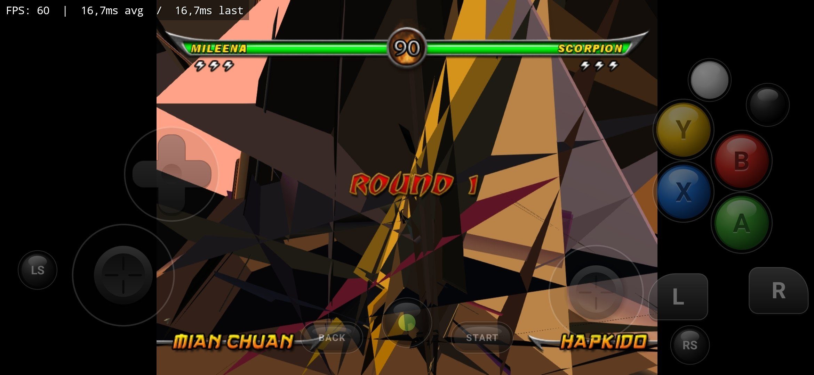
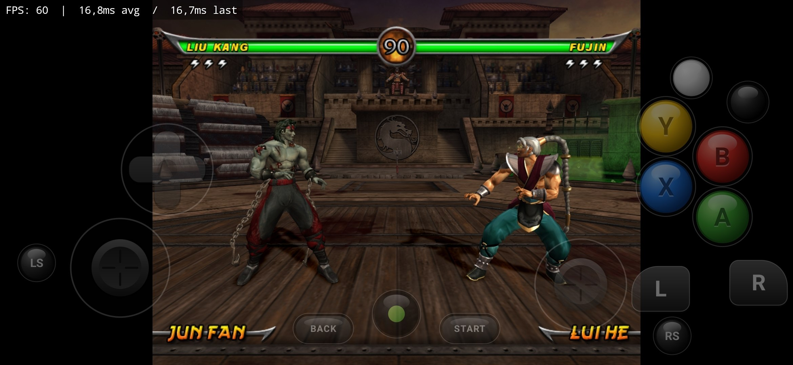
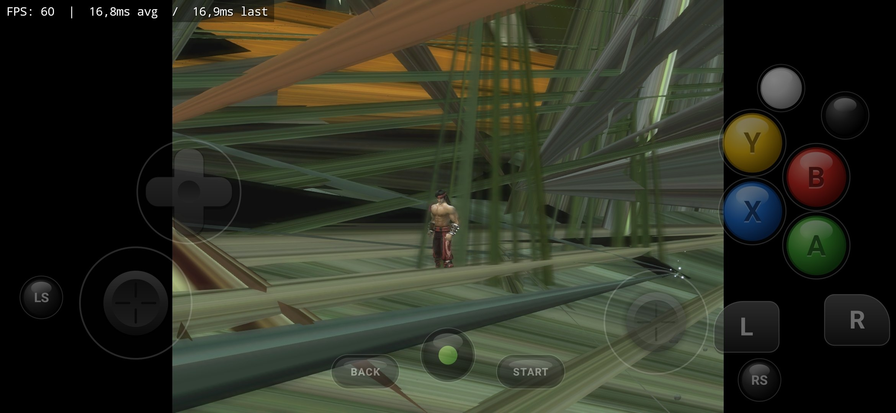
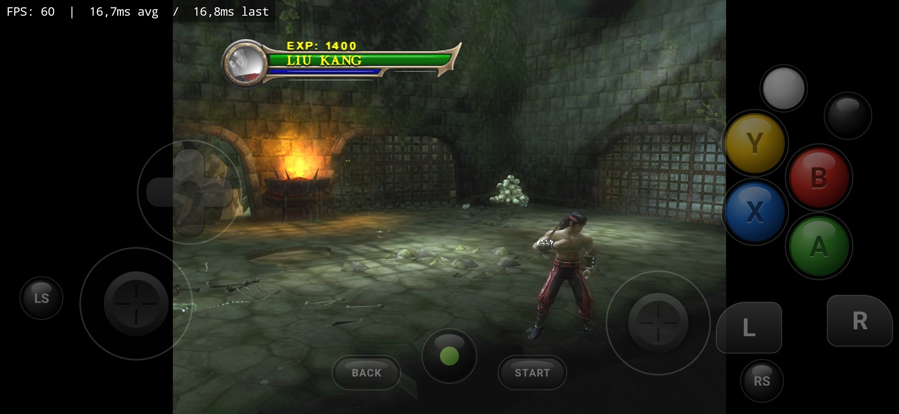

# Samsung Xclipse fixes (branch `xclipse-fixes`)

Three rendering bugs of hakuX 1.2.0 on Samsung's Xclipse GPU, their causes
as far as they could be narrowed down, and fixes. Found and checked on one
device; everything below says how far each part was tested.

## Device

| | |
|---|---|
| Phone | Samsung Galaxy S24 FE, Exynos 2400e |
| GPU | Samsung Xclipse 940 (AMD RDNA), vendor ID 0x144D |
| Driver | "Samsung Proprietary driver" (`VK_DRIVER_ID_SAMSUNG_PROPRIETARY`, 21), SPAL 25.3.3, git 9d9e5e5dc2, driverVersion 0x6403003 |
| Vulkan | 1.3.304 |
| Android | 16 |
| hakuX caps on this device (stock 1.2.0 log) | `bc=0 vids=1 push=0 push_desc=1 … eds1=1 eds2=1 bindless=1 ahb=1`, `sscaled=1`, `local_read=0` |

## Bugs, causes, fixes

### 1. Skinned characters explode (Mortal Kombat: Armageddon)

* **Symptom:** the stage, HUD and menus are right; the fighters are huge
  chaotic spiky triangles.
* **Cause (narrowed by A/B):** dynamic vertex input / extended dynamic
  state on Samsung's driver. With `vids` off and `eds1` on, the strides go
  through `vkCmdBindVertexBuffers2`; with `vids` on, through
  `vkCmdSetVertexInputEXT`. A build that already had `-vids` but kept
  `eds1=1 eds2=1` still showed the spikes; adding `-eds1,-eds2` (everything
  in the pipelines) fixed them.
* **Tested fix:** `HAKUX_HLE_CAPS=-bc,-fbfetch,-bindless,-vids,-ahb,-eds1,-eds2`
  (plus `HAKUX_HLE_QUIRKS=+ds_same_load,+z_eq_w,+no_push_desc,+fresh_clear`),
  set with `Os.setenv` at the start of `NativeCoreActivity.onCreate`.
  Per the A/B testing, `-eds1,-eds2` are the essential part; the other caps
  and quirks in that set came from earlier texture experiments and were
  not re-tested one by one in the final build.
* **Source fix (commit 1):** `vk/vkdev.c`: for vendor 0x144D or
  `VK_DRIVER_ID_SAMSUNG_PROPRIETARY`, `vids`, `eds1` and `eds2` are off by
  default (same effect as `debug.hakux.caps=-vids,-eds1,-eds2`), with a log
  line. Other drivers are unchanged.

| Before | After |
|---|---|
|  |  |

*MK Armageddon on the Xclipse 940, 60 fps. Before: official hakuX 1.2.0. After: the Xclipse test build.*

### 2. Skinned characters as flat planes (Mortal Kombat: Shaolin Monks)

* **Symptom:** with fix 1 alone, Armageddon was right but Shaolin Monks'
  fighters were large flat coloured planes; the scenery was right.
* **Cause:** the vertex programs index the constant bank per vertex,
  `c[A0 + n]` (bone matrices), and the bank is a dynamic **uniform** buffer
  (`VshConst`, set 1). On this driver that relative indexing returned wrong
  values; the scenery uses constant indices and was fine. (The push block
  already lives in a storage buffer on Xclipse, as its push constants are
  128 bytes.)
* **Tested fix:** binary patch of `libhakuxcore.so`: `VshConst` / `FfConst`
  declared as `buffer` instead of `uniform`, and the set-1 layout, pool and
  descriptor write use `VK_DESCRIPTOR_TYPE_STORAGE_BUFFER_DYNAMIC` (same
  std140 layout, same arena window and dynamic offsets).
* **Source fix (commit 2):** new quirk `HLE_QUIRK_CONST_SSBO`
  (`const_ssbo`), on for Samsung only; `g_hle_const_ssbo` (shader/ff.h)
  switches the two GLSL blocks to `readonly buffer` and `hle_draw_init`
  uses the storage-buffer descriptor type for set 1. `readonly` is new
  compared to the tested binary (Vulkan requires `NonWritable` storage
  buffers in the vertex stage unless `vertexPipelineStoresAndAtomics` is
  enabled). `HAKUX_HLE_QUIRKS=-const_ssbo` turns it off.

### 3. Stretched scenery polygons (Mortal Kombat: Shaolin Monks)

* **Symptom:** with fixes 1 and 2, the fighters were right but parts of the
  scenery were stretched polygons.
* **Cause:** vertex programs fetch NV2A S32K (SHORT) attributes as
  `R16…_SINT`. The Xclipse 940 has no vertex-buffer `R16G16B16_SINT`, so
  `vfmt()` fell back to `R16G16B16A16_SINT`, which reads the next 2 bytes as
  `w`. `R16G16B16_SSCALED` is supported and gives the same values as floats
  (`w = 1`), and the program converts with `vec4(v_in)` either way.
* **Tested fix:** one-instruction patch of `libhakuxcore.so` at file offset
  0x31e144 (`cbz x19` → `b`): every vertex-program S32K attribute takes
  the SSCALED table (kind 0).
* **Source fix (commit 3):** `vk/draw.c vat_format()`:
  - any driver: a program's n-component S32K attribute whose SINT format is
    missing but whose SSCALED format exists uses SSCALED instead of the
    over-reading four-component fallback (drivers with the SINT formats,
    e.g. Adreno, are unchanged);
  - new quirk `HLE_QUIRK_S32K_SCALED` (`s32k_scaled`), on for Samsung only:
    every program S32K attribute as SSCALED, which is what the tested patch
    did.

| Before | After |
|---|---|
|  |  |

*MK Shaolin Monks on the Xclipse 940, 60 fps. Before: a test build with fixes 1 and 2 only (fighters already right, scenery stretched). After: 1.2.0-xclipse-V13 (all three fixes).*

Builds were cumulative on the device: fix 1 fixed Armageddon; fix 1 + 2
fixed Shaolin Monks' fighters; fix 1 + 2 + 3 (test build
`1.2.0-xclipse-V13`) fixed both games completely, at 60 fps.

## What was and was not tested

* **On the device:** only the patched official 1.2.0 APK
  (`1.2.0-xclipse-V13`), made as described in `xclipse/README.md`
  (environment variables + byte patches).
* **The source commits on this branch have not been built with the NDK or
  run on a device.** They were checked on a Linux host only:
  - `gcc -fsyntax-only -Wall` of `vk/vkdev.c`, `vk/quirks.c`, `vk/draw.c`
    against Vulkan-Headers and volk (with and without `__ANDROID__`, using a
    stub `sys/system_properties.h`): no new warnings or errors;
  - the host tests `tests/hle` test_ffgen, test_vsh, test_ffhw, test_psh
    built with gcc and passing;
  - the generated `VshConst` / `FfConst` vertex shaders, with
    `g_hle_const_ssbo` on and off and the push block in push constants or
    the storage buffer, compiled with glslang for Vulkan 1.3.

## Not changed, possibly related

* `vfmt()`'s four-component fallback also over-reads for 3-component
  `UB_OGL` (R8G8B8_UNORM) and `S1` (R16G16B16_SNORM) where a driver lacks
  them; no game was seen to hit that here.
* The test build also turned off `bc`, `bindless`, `ahb` and turned on the
  Mali quirks `ds_same_load`, `z_eq_w`, `no_push_desc`; the source commits
  do not, since nothing pointed at them for these bugs.

## Files

* Commits 1–3: the source fixes (`hw/xbox/hle/vk/vkdev.c`, `vk/quirks.[ch]`,
  `vk/draw.c`, `shader/ff.h`, `shader/ff_gen.c`, `shader/vsh.c`).
* `xclipse/img/`: before/after screenshots from the device.
* `xclipse/`: how the tested APK was made: exact byte patches
  (`patch_libhakuxcore.py`), the smali diff (`smali_V13.diff`) and a
  script that rebuilds the APK from the official one (`rebuild_apk.py`).
